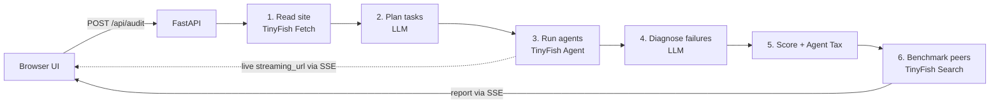

# AgentLighthouse

**Google Lighthouse tells you how your website performs for humans.
AgentLighthouse tells you whether an AI agent can actually use it.**

   


**[Demo video](<VIDEO_LINK>) · [Project post](<POST_LINK>) · [Benchmark results](#benchmark-results) · [How we use TinyFish](#how-we-use-tinyfish)**

---

## The problem

AI agents now browse, compare, book and buy on people's behalf. Bain estimates agents could handle **15–25% of US e-commerce, $300–500 billion, by 2030**.

But websites were built for human eyes. Cookie banners cover buttons. Icons have no labels. Login walls, CAPTCHAs and infinite scroll quietly turn agents away.

The site owner never finds out. A failed agent leaves no complaint, no support ticket and no analytics trail.

## The solution

AgentLighthouse sends **real TinyFish web agents** to do **real tasks** on your website, such as "find a product price" or "reach checkout". You watch them work live. Then you get:

- **Agent-Readiness Score (0–100)** and a letter grade
- **The exact step where each agent got stuck**, with the agent's own trace
- **An AI diagnosis** of each failure: the blocker, the root cause, and a **copy-paste fix**
- **Agent Tax**: what every AI agent pays, in steps and dollars, to get a job done on your site
- **Competitor comparison**, using peers found automatically with TinyFish Search

### Why this is different

Static "agent-readiness" checkers already exist, such as Cloudflare's isitagentready and Frase. They **read files** like robots.txt, llms.txt and structured data.

AgentLighthouse **watches an agent try to do the job**. A site can pass every file check and still trap an agent behind a cookie wall on the checkout page. Think of it as a spec sheet versus a crash test.

---

## How we use TinyFish

TinyFish is not a plugin here. **It is the measurement instrument.** The score is literally what happened when a real agent tried. Remove TinyFish and there is no product.

| TinyFish API | What it does in AgentLighthouse | Code |
|---|---|---|
| **Agent API** (`/v1/automation/run-async` + `/v1/runs/{id}`) | Runs 4 real tasks per site. Each agent's outcome, step count and step-by-step trace are the core measurement. | [`app/tinyfish.py`](app/tinyfish.py) `run_agent()`, [`app/runner.py`](app/runner.py) |
| **Live browser stream** (`streaming_url`) | Streams each agent's real browser into the UI while it works. | [`app/runner.py`](app/runner.py), [`web/app.js`](web/app.js) |
| **Fetch API** | Reads the homepage, `robots.txt`, `llms.txt` and `sitemap.xml`. Fetch error codes such as `bot_blocked`, `empty_content` and `login_required` become readiness signals. | [`app/signals.py`](app/signals.py) |
| **Search API** | Finds the site's competitors, so every score is relative rather than abstract. | [`app/signals.py`](app/signals.py) `peers()` |

Implementation details:

- **Structured results.** Every agent run uses `output_schema`, so TinyFish returns `{outcome, answer, blocker, blocker_detail, final_url}`. The blocker comes from a fixed taxonomy.
- **Completion is not success.** We never treat `COMPLETED` as success. That status only means the browser worked, so we always read the task's own `outcome` field.
- **Safe goals.** Every goal forbids login, account creation, personal data, payment and form submission.
- **Concurrency.** A semaphore keeps at most 2 agents running at once, which matches the pay-as-you-go limit.
- **Caching.** Every TinyFish call is cached to disk ([`app/cache.py`](app/cache.py)). This makes reruns free and lets the whole demo replay offline.

---

## Quick start

### Demo mode: 2 minutes, no API keys

```bash
git clone https://github.com/<TEAM>/agentlighthouse && cd agentlighthouse
pip install -r requirements.txt
DEMO_MODE=1 uvicorn app.main:app --port 8000
```

Open **http://localhost:8000** and click **"Try a sample shop"**. Demo mode replays real recorded TinyFish runs from `data/cache/`.

### Live mode: audit any website

```bash
cp .env.example .env      # add your keys (see below)
uvicorn app.main:app --port 8000
```

You can also run an audit from the terminal:

```bash
python -m scripts.audit_cli https://example-store.com
```

### Configuration

| Variable | Required | Description |
|---|---|---|
| `TINYFISH_API_KEY` | Live mode | Get one at [agent.tinyfish.ai/api-keys](https://agent.tinyfish.ai/api-keys) |
| `LLM_BASE_URL` | Live mode | Any OpenAI-compatible endpoint |
| `LLM_API_KEY` | Live mode | Key for that endpoint |
| `LLM_MODEL` | Live mode | Model name, which must support JSON output mode |
| `DEMO_MODE` | No | `1` replays from cache with no network and no keys |

---

## How it works



1. **Read the site.** TinyFish Fetch pulls the homepage, `robots.txt`, `llms.txt` and the sitemap, and we compute six machine-readability signals.
2. **Plan tasks.** An LLM classifies the site as `ecommerce`, `saas`, `travel` or `services`, writes a realistic search query, and the task library picks 4 tasks.
3. **Run agents.** TinyFish web agents attempt each task. Their live browsers stream to the UI.
4. **Diagnose.** For every failed task, or any success that took more than twice the expected steps, an LLM reads the agent's step trace. It names the blocker, the root cause and a concrete fix. It must use only evidence in the trace.
5. **Score.** A deterministic, unit-tested score and the Agent Tax are calculated.
6. **Compare.** TinyFish Search finds 3 competitors, and we compare their machine-readability.

### Tasks per site type

| Site type | Tasks |
|---|---|
| E-commerce | Find support contact · Find refund policy · Find a product price · Reach checkout |
| SaaS | Find support contact · Find refund policy · Find plan pricing · Reach sign-up |
| Travel | Find support contact · Find refund policy · Search options · List offerings |
| Services | Find support contact · Find refund policy · List offerings · Reach enquiry form |

### Blocker taxonomy

`cookie_or_popup` · `captcha_or_bot_block` · `login_wall` · `element_not_found` · `unlabeled_control` · `slow_or_dynamic_content` · `confusing_navigation` · `other`

### Scoring

```
Score (0–100) = Task success (55) + Efficiency (20) + Machine readability (25)

Task success        = 55 × mean(outcome),  where success = 1, partial = 0.5, failure = 0
Efficiency          = 20 × mean(outcome × min(1, expected_steps / actual_steps))
Machine readability = reachable 6 + renders without JS 5 + llms.txt 4
                      + AI-friendly robots.txt 4 + sitemap 3 + title & description 3

Grade:     A ≥ 85 · B ≥ 70 · C ≥ 55 · D ≥ 40 · F < 40
Agent Tax: average steps per task × $0.016 (TinyFish's per-step price)
```

The full specification is in [`design.md`](design.md).

---

## Benchmark results

<!-- TODO: replace with numbers from data/leaderboard.json -->

On **<DATE>** we audited **<N> public websites** across e-commerce, SaaS, travel and services.

- **<X> of <N>** sites stopped an AI agent before checkout or sign-up.
- The most common blocker was **<BLOCKER>**.
- Agent Tax ranged from **$<A>** to **$<B>** per task.
- The LLM's blocker label matched human review in **<K> of 10** checked failures.

| Rank | Site type | Score | Grade | Avg steps | $ per task |
|---|---|---|---|---|---|
| 1 | <type> | <score> | <grade> | <steps> | <usd> |
| … | | | | | |

*This is a snapshot of public pages. Scores measure AI-agent usability, not business quality.*

---

## API

| Method | Endpoint | Description |
|---|---|---|
| `POST` | `/api/audit` | Body `{"url": "..."}`. Returns `{"audit_id": "..."}` |
| `GET` | `/api/audit/{id}/events` | Server-Sent Events stream: `stage`, `signals`, `tasks`, `task_update`, `task_done`, `diagnosis`, `score`, `peers`, `done`, `error` |
| `GET` | `/api/report/{domain}` | The saved report JSON |
| `GET` | `/api/leaderboard` | All benchmarked sites, sorted by score |

---

## Project structure

```text
app/
  main.py        FastAPI routes + SSE streaming
  audit.py       the 6-step pipeline
  tinyfish.py    every TinyFish call (Agent, Fetch, Search)
  runner.py      one task -> one result, max 2 agents at once
  signals.py     machine-readability signals + competitor discovery
  tasks.py       task library, goal prompts, output schema, site planning
  diagnose.py    LLM failure diagnosis
  score.py       score, grade, Agent Tax
  llm.py         one function: prompt in, JSON out
  cache.py       disk cache + DEMO_MODE replay
web/             single-page UI (HTML + Tailwind + vanilla JS)
scripts/         smoke test, CLI audit, benchmark
data/            cache, reports, leaderboard
tests/           scoring and signal tests
design.md        the build specification
agents.md        log of all AI-assisted work
```

### Run the tests and the benchmark

```bash
pytest -q
python -m scripts.benchmark    # audits data/sites.txt and writes data/leaderboard.json
```

---

## Tech stack

**Backend:** Python 3.11, FastAPI, httpx, Pydantic
**Web agents and web data:** TinyFish Agent, Fetch and Search APIs
**AI:** any OpenAI-compatible LLM for site classification and failure diagnosis
**Frontend:** a single HTML page, Tailwind CSS and vanilla JavaScript, with no build step
**Storage:** JSON files

---

## Business model

| Plan | Price per month | Includes |
|---|---|---|
| Free | ₹0 | 1 audit, 4 tasks, public report |
| Starter | ₹1,499 | Weekly audits, fix list, score-drop alerts |
| Growth | ₹4,999 | Daily journey checks, competitor audits, CI webhook |
| Agency | ₹14,999 | 20 client sites, white-label reports |

**Unit cost.** One task averages about <STEPS> agent steps × $0.016, which is about $<COST>. Every paid plan keeps a gross margin of about 65% or more.

---

## Limitations

- **Scores vary slightly.** Agents are non-deterministic, so scores can move a few points between runs. Real blockers, such as a cookie wall over "Add to cart", reproduce every time.
- **Public pages only, by design.** There are no logins, payments or form submissions.
- **Simplified parsing.** robots.txt parsing is simplified, and tasks are English-only for now.

## Roadmap

- [ ] Scheduled monitoring with score-drop alerts
- [ ] A GitHub Action that fails a deploy when an agent can no longer reach checkout
- [ ] Auto-generated fix pull requests
- [ ] Multi-language tasks
- [ ] An MCP endpoint, so agents can check a site's readiness before visiting

---

## Built with AI, transparently

We used AI coding assistants. [`agents.md`](agents.md) logs everything AI generated, what we rejected, and what a human verified at each phase gate.

The team chose the problem, the behavioural-testing approach, the Agent Tax metric, the scoring weights and the blocker taxonomy, and reviewed the benchmark results.

## Team

| Name | Role | Links |
|---|---|---|
| <NAME> | Backend & TinyFish | <GitHub / LinkedIn> |
| <NAME> | ML & scoring | <GitHub / LinkedIn> |
| <NAME> | Frontend | <GitHub / LinkedIn> |
| <NAME> | Pitch & docs | <GitHub / LinkedIn> |

## License

MIT
